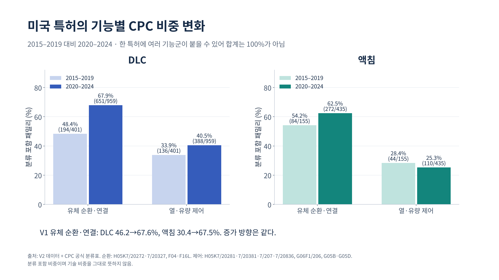
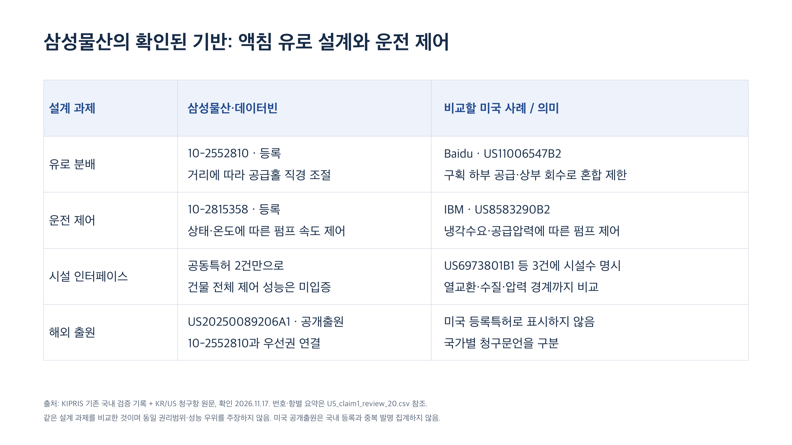
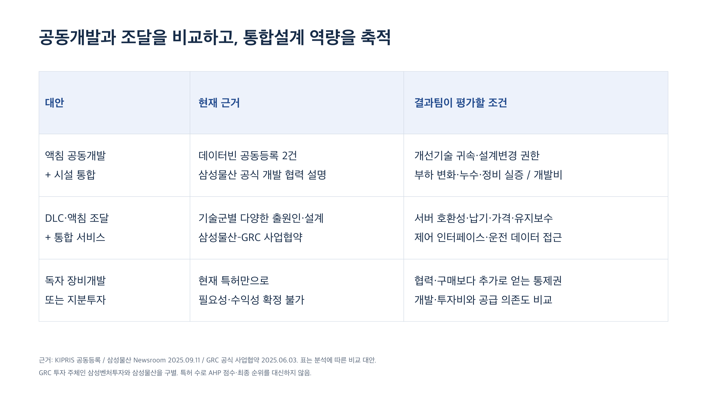
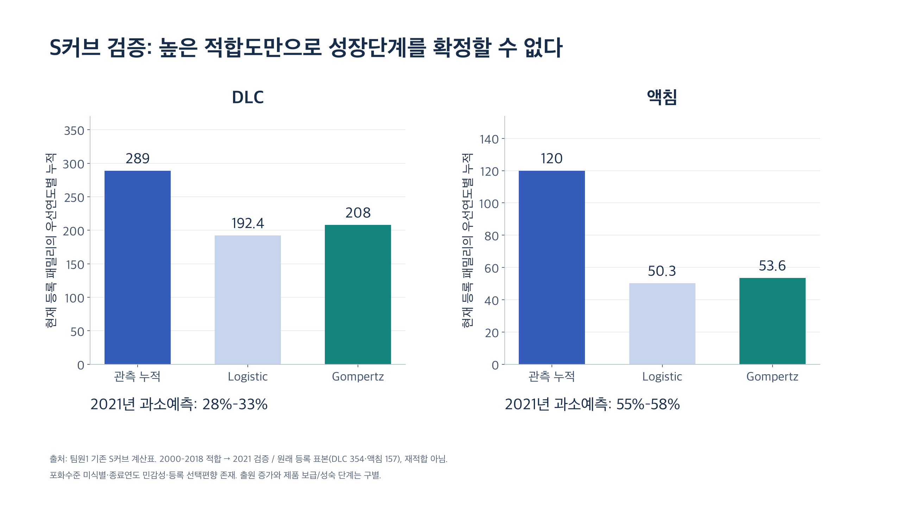
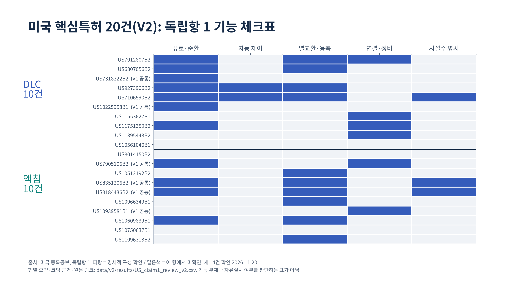

# 발표용 도표

PNG 파일을 장표에 삽입하고 같은 번호의 [대본](../발표대본.md)을 사용하세요. 확대·편집용 SVG는 [editable/](editable/)에 있습니다. 전체 논리는 [인계서](../결과팀_인계.md), 그림의 계산값은 [data/results/final/](../../data/results/final/)에서 확인할 수 있습니다.

| 01 · 출원 추이 | 02 · 출원인·HHI |
|---|---|
|  |  |
| 03 · CPC 기능 변화 | 04 · 청구항 기능 비교 |
|  |  |
| 05 · 자사 기술 비교 | 06 · 확보 방식·결과팀 인계 |
|  |  |
| 부록 A1 · S커브 검증 | 부록 A2 · 20건 기능 행렬 |
|  |  |

## 07 · Logistic·Gompertz 곡선 — 본문 참고자료

실선은 2000–2021 적합, 점선은 모형 외삽 예시입니다. 장표에는 ‘참고용’을 표시하고 불안정성은 [07 대본](../발표대본.md)으로 설명합니다. 두 모형을 실제로 재현한 수치는 [적합 결과](../../data/results/final/scurve_fits.json)와 [곡선 계산표](../../data/results/final/scurve_curves.csv)에 있습니다.

본문 시간을 줄일 때는 01+02, 03+04를 각각 한 장으로 합칠 수 있습니다. A1은 단계 판정을 보류한 이유, A2는 개별 특허의 코딩 근거를 확인하는 부록입니다.
