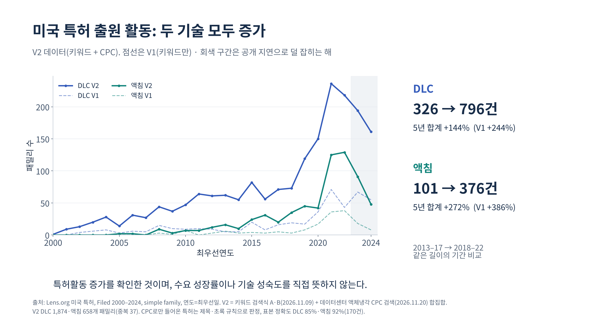
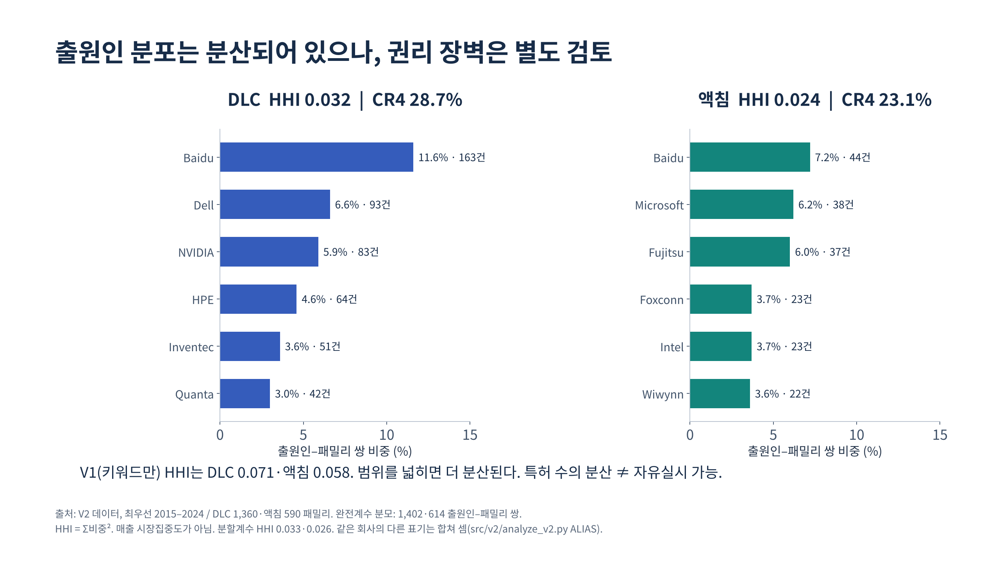
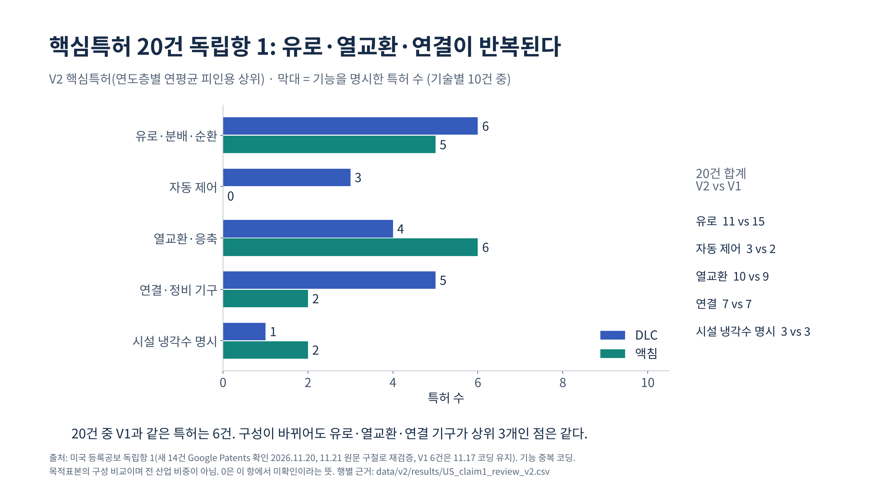
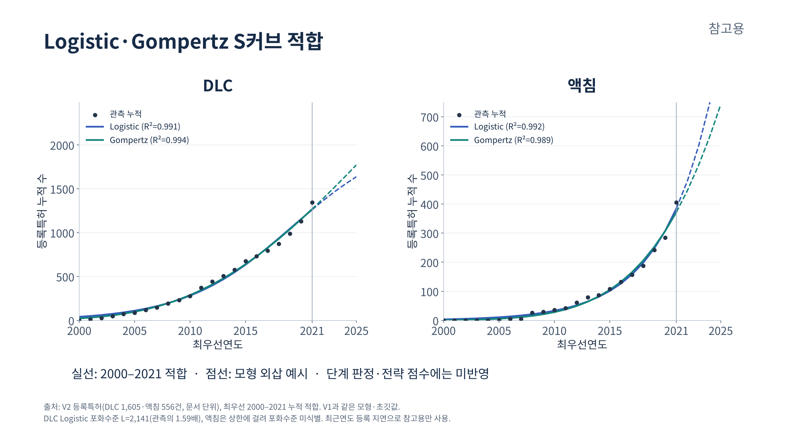
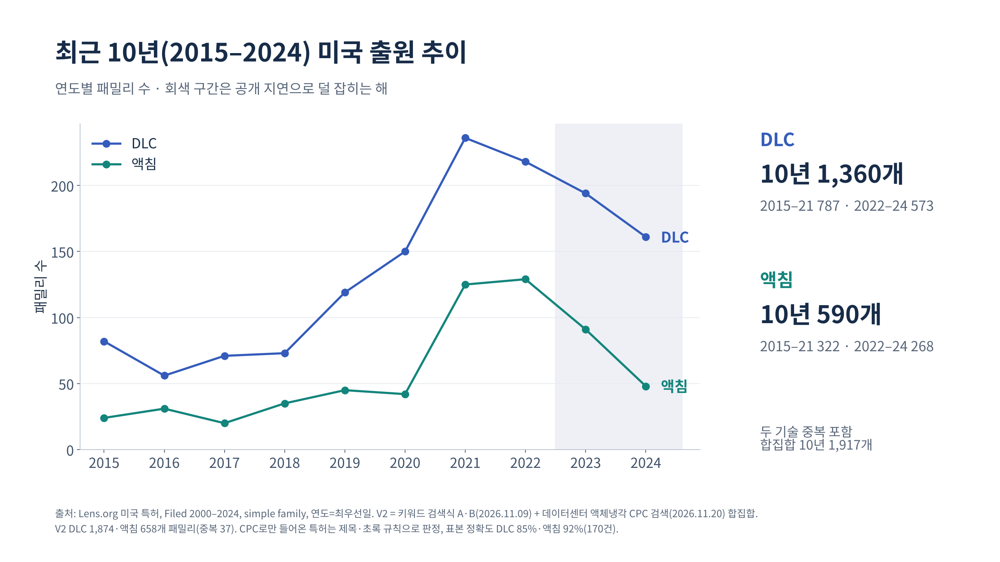
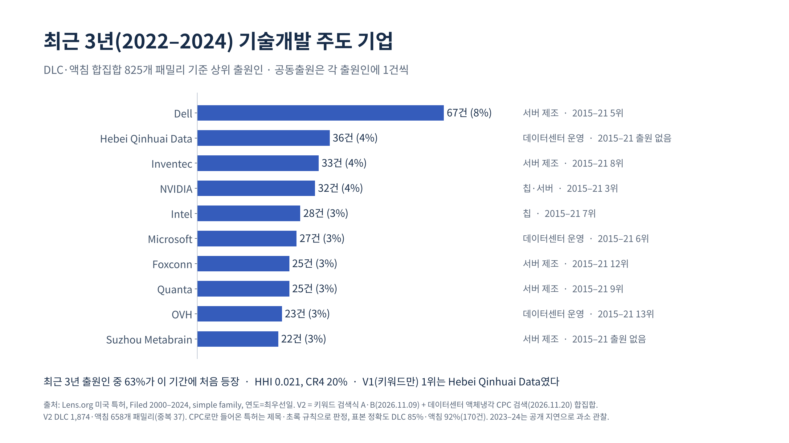
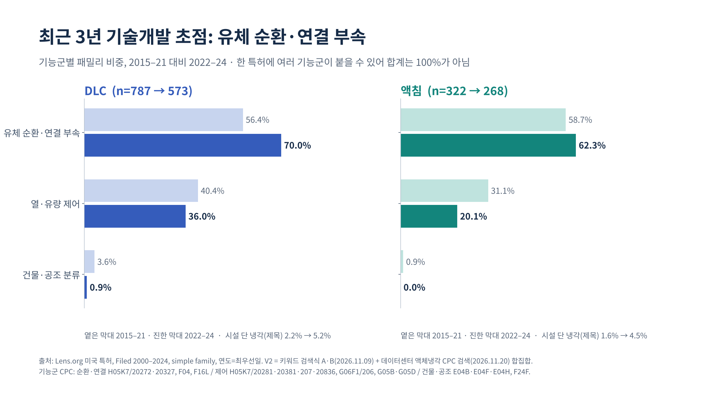
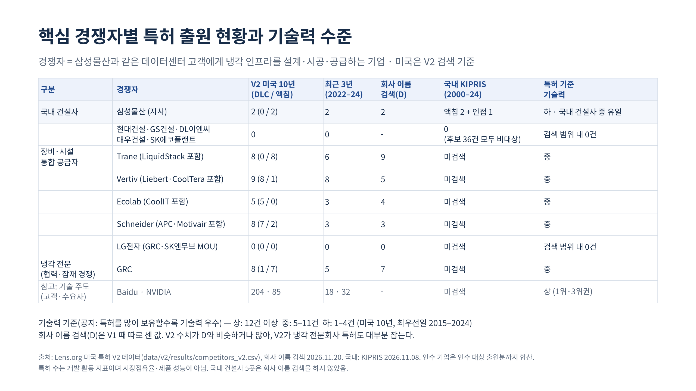
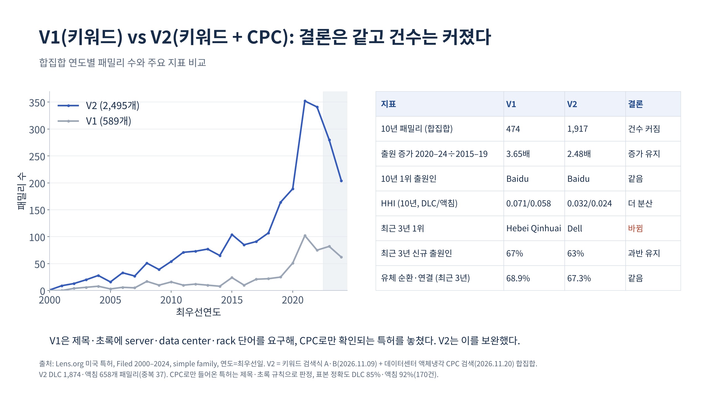

# 발표용 도표

> **V2 검토 브랜치:** 01·01b·02·03·07·08·09·10·A1·C1은 V2(키워드+CPC) 데이터 그림, 04·A2는 V2 핵심특허 20건 그림이다. 05·06은 main과 같다. V2 계산값은 [data/v2/results/](../../data/v2/results/), 생성 코드는 [src/v2/figs_v2.py](../../src/v2/figs_v2.py)다.

PNG 파일을 장표에 삽입하고 같은 번호의 [대본](../발표대본.md)을 사용하세요. 확대·편집용 SVG는 [editable/](editable/)에 있습니다. 전체 논리는 [인계서](../결과팀_인계.md), 그림의 계산값은 [data/results/final/](../../data/results/final/)에서 확인할 수 있습니다.

| 01 · 출원 추이 | 02 · 출원인·HHI |
|---|---|
|  |  |
| 03 · CPC 기능 변화 | 04 · 청구항 기능 비교 |
|  |  |
| 05 · 자사 기술 비교 | 06 · 확보 방식·결과팀 인계 |
|  |  |
| 부록 A1 · S커브 검증 | 부록 A2 · 20건 기능 행렬 |
|  |  |

## 07 · Logistic·Gompertz 곡선 — 본문 참고자료

실선은 2000–2021 적합, 점선은 모형 외삽 예시입니다. 장표에는 ‘참고용’을 표시하고 불안정성은 [07 대본](../발표대본.md)으로 설명합니다. V2 적합 수치는 [곡선 계산표](../../data/v2/results/scurve_curves_v2.csv)와 [종료연도 검증](../../data/v2/results/scurve_holdout_v2.csv)에 있습니다.

본문 시간을 줄일 때는 01+02, 03+04를 각각 한 장으로 합칠 수 있습니다. A1은 단계 판정을 보류한 이유, A2는 개별 특허의 코딩 근거를 확인하는 부록입니다.

## 조별활동 2 추가 그림 (V2)

| 01b · 최근 10년 출원 추이 | 08 · 최근 3년 주도 기업 |
|---|---|
|  |  |
| 09 · 최근 3년 기술 비중 | 10 · 핵심 경쟁자 특허 현황 |
|  |  |
| 부록 C1 · V1 vs V2 비교 | |
|  | |

